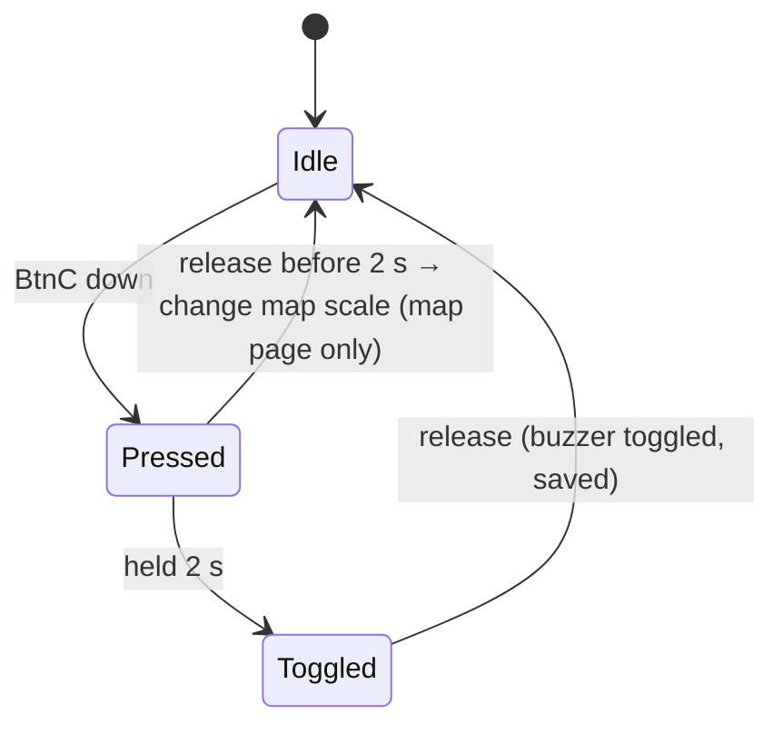
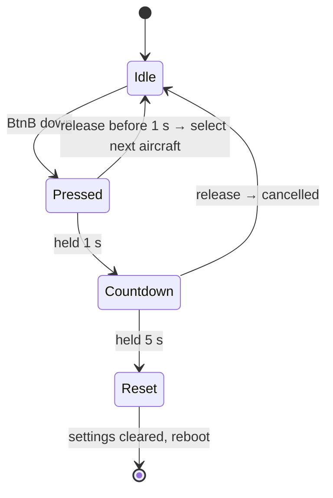
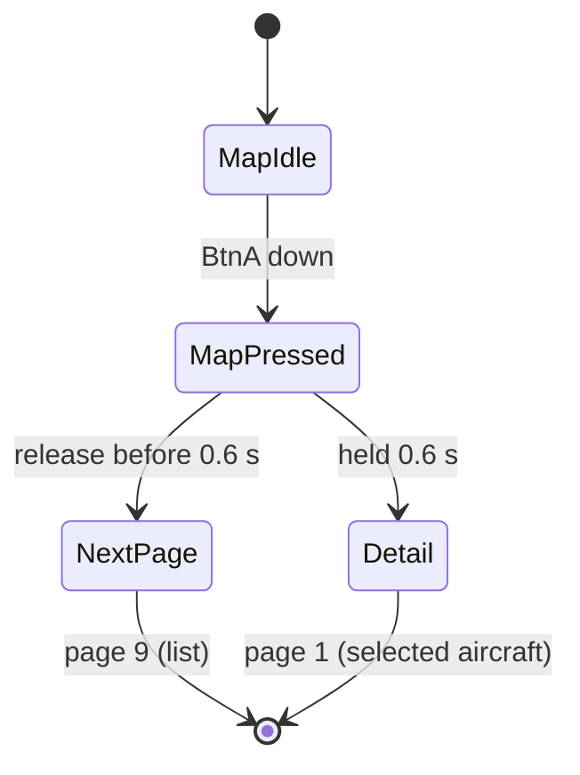
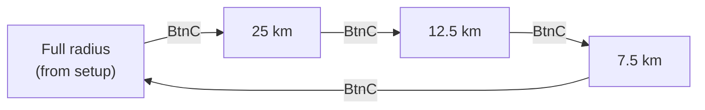
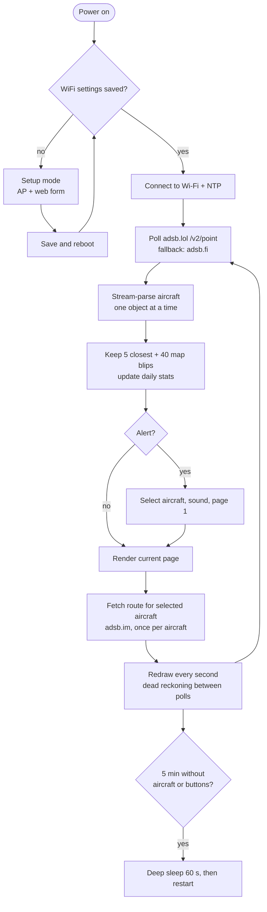

# nearPlane+ – ADS-B Tracker for M5StickC Plus 2


**nearPlane+** turns an `M5StickC Plus 2` that is dying in your stuff drawer (I know you have one, everybody does, no worries) into a portable, real-time aircraft tracker. No need to check Flightradar or anything else. It is perfect for aviation enthusiasts, curious minds, and anyone who has ever looked up at the sky and wondered, "What plane is that?"

This repository is a fork of [nearPlane](https://github.com/stevenselcuk/nearPlane) by **Steven J. Selcuk**. The original idea, base firmware and installation workflow come from him. This fork keeps that foundation and extends it with more pages, multiple aircraft, a radar map, alerts, daily statistics and several reliability fixes. See [Credits](#credits).

**Brand vs. technical names:** the application is branded **nearPlane+**. Technical identifiers keep their ASCII-safe, upstream-compatible names: the repository `nearplane-plus`, the Arduino sketch `nearPlane/nearPlane.ino` and the setup AP `nearPlane-ADSB-Tracker-Setup`.

The tracker normally fetches data from **adsb.lol**, a free, open-source, community-driven project that collects and provides real-time `ADS-B` (Automatic Dependent Surveillance-Broadcast) data from aircraft around the world. This allows you to see detailed flight information without needing your own expensive radio hardware. If adsb.lol rate-limits the device, it automatically switches to the **adsb.fi** open-data fallback. Flight routes are resolved through **adsb.im**.

## Features

### Tracking and display

- **Real-time tracking** – the closest aircraft's data is updated every few seconds, with dead reckoning between API polls.
- **Multiple aircraft** – the 5 closest aircraft are tracked; `BtnB` selects the next one (`AC 2/5` in the footer).
- **Ten-page interface** – flight data, attitude, speeds, autopilot, identity, environment, direction/CPA, radar map, nearby list and daily statistics.
- **Flight route information** – departure and arrival airports (IATA codes) for most commercial flights, fetched once per selected aircraft.
- **Radar map** – north-up top-down view with up to 40 aircraft, range rings and four scale steps.
- **Direction and distance** – arrow to the aircraft, distance in km, bearing, approach/recede trend and closest point of approach (CPA).
- **Type and airline names** – ICAO type codes (`B738` → `Boeing 737-800`) and callsign prefixes (`RYR1234` → `Ryanair`), with a marquee for long header lines.
- **Daily statistics** – number of aircraft, closest, highest and fastest aircraft of the day, persisted across reboots.

### Alerts and hardware

- **Emergency alerts** – aircraft with emergency squawk codes (7500, 7600, 7700) are highlighted.
- **Military and rare aircraft alerts** – a coloured banner, a distinct sound and automatic selection of the aircraft.
- **Audible alerts** – a tone plays when a new aircraft is detected; alerts have their own sounds.
- **Buzzer on/off** – hold `BtnC` for 2 seconds to mute or unmute all sounds; the setting is saved.
- **Battery and charging indicator** – battery level with colour coding and a charging icon in the header.
- **Clock in the header** – synchronised over NTP; configurable UTC offset in the sketch.
- **Easy web-based configuration** – an access-point setup mode for Wi-Fi, location, scan radius and the User-Agent contact.
- **Factory reset** – hold `BtnB` for 5 seconds to clear all settings and return to setup mode.
- **Automatic deep sleep** – after 5 minutes without aircraft or button activity the device sleeps for 60 seconds and restarts.

## Requirements

| Item | Details |
|---|---|
| Board | M5StickC Plus 2 (M5Stack Arduino core) |
| Libraries | `M5Unified`, `ArduinoJson` 7.x |
| Network | 2.4 GHz Wi-Fi with internet access (adsb.lol, adsb.fi, adsb.im, NTP) |
| USB | USB-C data cable; CH9102 driver on Windows |
| API contact | Your own e-mail or URL in the setup form's **User-Agent** field (required by adsb.lol) |

The sketch must live in a folder with the same name: `nearPlane/nearPlane.ino`. Otherwise the linker reports undefined references to `setup` and `loop`.

## Before first use

The first-start setup form asks for a **User-Agent** that identifies your device to adsb.lol. Enter your real e-mail or a URL, for example `nearPlane-M5Stick/1.0 (you@example.com)`. The pre-filled `CHANGE-ME` placeholder is rejected, as are values without `@` or `http(s)://`.

The value is stored in flash under the NVS key `ua` and is used for adsb.lol, the adsb.fi fallback and route requests. The built-in `USER_AGENT` constant is only a dummy fallback (`changeme@example.com`) and is not a valid contact. If you upgrade from a version without this field, reset the settings (hold `BtnB` for 5 seconds) and enter your own contact in the setup form. A generic or shared contact can cause HTTP 403.

## Install

The upstream project is available in **M5Burner** as "nearPlane". This fork contains additional features, so build it from source using the guide below.

### Prerequisites

- Buy an M5StickC Plus 2 (ask your partner before ordering one).
- Install [Arduino IDE](https://www.arduino.cc/en/software).
- Get a USB-C cable for programming and charging.

### Installation guide

Follow these steps to compile and upload the firmware to your M5StickC Plus 2.

#### 1. Install the USB driver

The M5StickC Plus 2 uses a CH9102 chip for USB communication. Install the driver for your operating system so your computer can communicate with the device.

- **Windows**: [Download and install the CH9102 driver](https://docs.m5stack.com/en/core/M5StickC%20PLUS2).
- **macOS**: macOS should detect the device automatically. If not, the driver is available on the same M5Stack documentation page.

#### 2. Configure Arduino IDE for M5Stack

1. Open the Arduino IDE.
2. Go to **File > Preferences** (or **Arduino IDE > Settings...** on macOS).
3. In the "Additional boards manager URLs" field, paste:

   ```
   https://m5stack.oss-cn-shenzhen.aliyuncs.com/resource/arduino/package_m5stack_index.json
   ```

4. Click **OK**.

#### 3. Install M5StickC Plus 2 board support

1. Go to **Tools > Board > Boards Manager...**.
2. Search for `M5Stack`.
3. Install the **M5Stack Boards** package by M5Stack.

#### 4. Install required libraries

1. Go to **Tools > Manage Libraries...** (or **Sketch > Include Library > Manage Libraries...**).
2. Search for and install:
   - `M5Unified` (latest version).
   - `ArduinoJson` by Benoit Blanchon (7.x).

#### 5. Load and flash the firmware

1. Clone this repository or download the source code.
2. Open `nearPlane/nearPlane.ino` in the Arduino IDE.
3. No code edit is needed for the User-Agent: you will set your own contact in the setup form (see [Before first use](#before-first-use)).
4. Optionally set `gmtOffset_sec` to your UTC offset so the clock shows local time.
5. Connect the M5StickC Plus 2 to your computer with the USB-C cable.
6. Go to **Tools > Board** and from the "M5Stack Arduino" section select **M5StickCPlus2**.
7. Go to **Tools > Port** and select the serial port of your device (e.g. `COM3` on Windows, `/dev/cu.wchusbserial...` on macOS).
8. Click **Upload** (the arrow icon) to compile and flash the firmware.

### Device configuration

After a successful flash, the device boots into **SETUP MODE** for the first time (or after a settings reset).

1. On your phone or computer, connect to the Wi-Fi network **`nearPlane-ADSB-Tracker-Setup`**.
2. Open `http://192.168.4.1` in a browser.
3. Fill in:
   - **WiFi Network (SSID)** – the name of your local 2.4 GHz network.
   - **WiFi Password** – the password for that network.
   - **Your Latitude** – e.g. `41.015000`.
   - **Your Longitude** – e.g. `28.97000`.
   - **Scan Radius (NM, max 250)** – the radius around your location, in nautical miles (e.g. `50`; 1 NM = 1.852 km).
   - **User-Agent** – your e-mail or URL; the pre-filled `CHANGE-ME@example.com` is rejected. The value is stored in flash and used for adsb.lol, adsb.fi and route requests.
4. Click **Save & Reboot**.

The device saves the settings, restarts, connects to your Wi-Fi and starts tracking. Stats and the clock require a working NTP connection.

## Usage

### Controls

| Page | `BtnA` short | `BtnA` long (0.6 s) | `BtnB` short | `BtnB` hold 1 s → 5 s | `BtnC` short (side/PWR) |
|---|---|---|---|---|---|
| 1–6 Aircraft data | next page | next page | next aircraft | countdown → reset | – |
| 7 Direction / CPA | next page | next page | next aircraft | countdown → reset | – |
| **8 Radar map** | next page | **jump to page 1 (detail)** | next aircraft **inside current scale** | countdown → reset | **change scale** |
| 9 Nearby list | next page | next page | next aircraft (highlighted row) | countdown → reset | – |
| 10 Statistics | next page | next page | – (no visible effect) | countdown → reset | – |

Notes:

- On pages other than the map, `BtnA` acts immediately on press. On the map it acts on release so a long press can be distinguished from a short one.
- `BtnC` is the third button of the StickC Plus 2 (the power button, exposed as `M5.BtnPWR`).
- **`BtnC` hold 2 seconds on any page toggles the buzzer.** A "Sound ON/OFF" message appears, and a crossed-out speaker icon is shown next to the battery while muted. The setting survives reboots and is cleared by a settings reset. Alerts remain visible; only the sounds are muted.
- `BtnC` short press acts on release, so it can be distinguished from the 2-second hold.
- Releasing `BtnB` during the reset countdown cancels the reset.

### BtnC behaviour



### BtnB behaviour



### BtnA behaviour on the radar map



### Pages

Ten pages, advanced with `BtnA`. Pages 1–7 show the currently selected aircraft; pages 8–10 are overview pages.

```mermaid
flowchart LR
    P1["1 Flight data<br/>ALT / GS / ROUTE"]
    P2["2 Attitude<br/>HDG / V/S / ROLL"]
    P3["3 Speeds<br/>MACH / IAS-TAS / GEOM ALT"]
    P4["4 Autopilot<br/>AP ALT / HDG / MODE"]
    P5["5 Identity<br/>SQK / ICAO / REG"]
    P6["6 Environment<br/>OAT-TAT / WIND / RSSI"]
    P7["7 Direction<br/>arrow / distance / trend / CPA"]
    P8["8 Radar map<br/>north-up, scalable"]
    P9["9 Nearby list<br/>5 closest aircraft"]
    P10["10 Statistics<br/>today's records"]

    P1 -->|BtnA| P2 -->|BtnA| P3 -->|BtnA| P4 -->|BtnA| P5 -->|BtnA| P6 -->|BtnA| P7
    P7 -->|BtnA| P8 -->|BtnA| P9 -->|BtnA| P10 -->|BtnA| P1
    P8 -. "BtnA long press (0.6 s)" .-> P1
    P8 -. "BtnC: scale 100% / 25 / 12.5 / 7.5 km" .-> P8

    classDef aircraft fill:#1f3a5f,stroke:#4a90d9,color:#fff;
    classDef overview fill:#2d4a2d,stroke:#6abf69,color:#fff;
    class P1,P2,P3,P4,P5,P6,P7 aircraft;
    class P8,P9,P10 overview;
```



An **alert** (emergency, military or rare aircraft) automatically selects that aircraft, jumps to page 1 and plays a sound.

### Radar map scale

`BtnC` cycles the map radius; the inner ring is always half of the outer one.



Steps not smaller than the configured radius are skipped. If the selected aircraft is outside the current scale, it is shown as a yellow dot on the rim and its distance appears in the footer (e.g. `SEL 24.1 km`).

### Alerts

| Level | Banner colour | Trigger |
|---|---|---|
| EMERGENCY | red | emergency flag or squawk 7500 / 7600 / 7700 |
| MILITARY | orange | military flag in the database |
| RARE | cyan | A380, B747-400/-8/SP, An-124, An-225, Beluga/BelugaXL, Dreamlifter, C-5M, Il-76, A340-600 |

The same aircraft does not trigger the alert twice (the last 8 are remembered). Alerted aircraft are kept in the list of 5 even when they are not the closest.

## How it works



### Polling intervals

| Situation | Interval |
|---|---|
| Aircraft found | 15 s |
| No aircraft | 30 s |
| Other error (parse, 5xx, timeout) | 60 s |
| HTTP 429 (rate limit) | 20 s, doubling up to 120 s (the `Retry-After` header wins); the fallback server is tried immediately; last data stays on screen |
| Redraw of pages 7–9 (local calculation, no API call) | 1 s |

If adsb.lol answers 429, the sketch immediately retries the same request on `opendata.adsb.fi` and keeps using it until the primary block expires.

Between polls, positions on pages 7–9 are recalculated every second from ground speed and track (no API calls). A long airline/type line in the header scrolls as a marquee.

## Troubleshooting

| Symptom | Likely cause |
|---|---|
| HTTP 403 "User-Agent too generic" | Enter your own e-mail or URL in the setup form's **User-Agent** field; the built-in fallback is a dummy address and will not work |
| HTTP 429 | adsb.lol rate limit (other clients behind the same IP or frequent reboots can cause it). The device shows "Rate limited" with a countdown, switches to adsb.fi and retries automatically |
| HTTP 426 | HTTP/1.0 request; the sketch uses HTTP/1.1 with chunked decoding |
| Linker error `undefined reference to setup/loop` | File/folder name mismatch (`nearPlane/nearPlane.ino`) |
| Reboot loop | Check the serial monitor (115200 baud) for the `Reset reason:` line |
| No reaction to `BtnC` | The power button is not detected by your board or library version |

## Data sources

- Primary: [adsb.lol](https://adsb.lol) (open data, ODbL).
- Fallback while adsb.lol rate-limits: [adsb.fi open data](https://adsb.fi) – personal, non-commercial use only; credit adsb.fi and link to https://adsb.fi.
- Route lookup: adsb.im.

## Limitations

- No compass: the arrow and map are always north-up.
- Stats and the clock need a working NTP connection.
- `setInsecure()` disables TLS certificate validation (acceptable for public flight data).
- Built-in type/airline tables cover about 100 types and 80 airlines; extend `TYPE_NAMES` / `AIRLINES` in the sketch.
- The scan radius is entered in nautical miles (max 250), not kilometres.

## Changelog

The detailed bilingual changelog (English/Slovak) is in [`nearPlane/CHANGELOG.md`](nearPlane/CHANGELOG.md).

### This fork

- Ten pages instead of six, including radar map, nearby list and daily statistics.
- Tracks the 5 closest aircraft and switches between them with `BtnB`.
- Direction page with dead reckoning, approach/recede trend, bearing and CPA.
- Emergency, military and rare aircraft alerts with coloured banners, sounds and automatic selection.
- Radar map with up to 40 aircraft and four scale steps.
- Daily statistics stored in NVS: aircraft count, closest, highest and fastest aircraft.
- Human-readable aircraft types and airline names, with a scrolling header line.
- Buzzer mute via `BtnC`, battery/charging indicator and clock in the header.
- Streaming JSON parsing for low memory usage; route fetched once per aircraft.
- Fixed HTTP 403/426/429 handling, automatic adsb.fi fallback, configurable User-Agent in the setup form, exponential polling backoff and serial diagnostics.
- Setup radius corrected to nautical miles (max 250) and deep sleep after inactivity.

### Upstream history

**v1.1 – Sep 10, 2025**

- **Flight route fetching**: switched to a `POST` request to the `https://api.adsb.lol/api/0/routeset` endpoint with the aircraft callsign, providing more accurate departure and arrival airports without external API keys.
- Solved previous issues with empty or incorrect route information.

**v1.0 – Sep 9, 2025**

- **Initial release**: bare/minimum working copy.

## Contributing

Contributions are welcome. If you would like to help improve this fork:

1. **Fork** this repository on GitHub.
2. Create a new **branch** for your feature or bug fix.
3. Make your changes and commit them with clear, descriptive messages.
4. Push your branch to your forked repository.
5. Create a **Pull Request (PR)** against this repository and explain the changes.

## Credits

This project is a fork of **[nearPlane](https://github.com/stevenselcuk/nearPlane)** by **[Steven J. Selcuk](https://github.com/stevenselcuk)**. Thank you for the original firmware, the detailed build and setup guide, the UI concept and for releasing the project under the MIT license. The base implementation and a large part of this README come from his work.

- Original project and author: [stevenselcuk/nearPlane](https://github.com/stevenselcuk/nearPlane)
- Original inspiration: [Reddit post by ufil1983](https://www.reddit.com/r/ADSB/comments/1nb56ld/nearest_aircraft_display/) and the [follow-up post](https://www.reddit.com/r/ADSB/comments/1nbsb3c/inspired_by_ufil1983s_nearest_aircraft_display_i/)
- Flight data: [adsb.lol](https://adsb.lol)
- Flight routes: [adsb.im](https://adsb.im)

## License

This project is open source under the **MIT License**. Original work Copyright (c) 2025 Steve J. Selcuk; fork modifications are distributed under the same license. See [`LICENSE`](LICENSE) for the full text.
