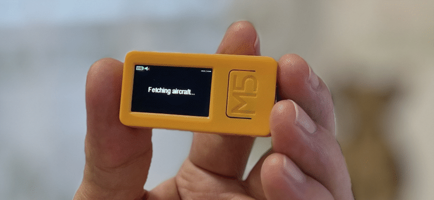
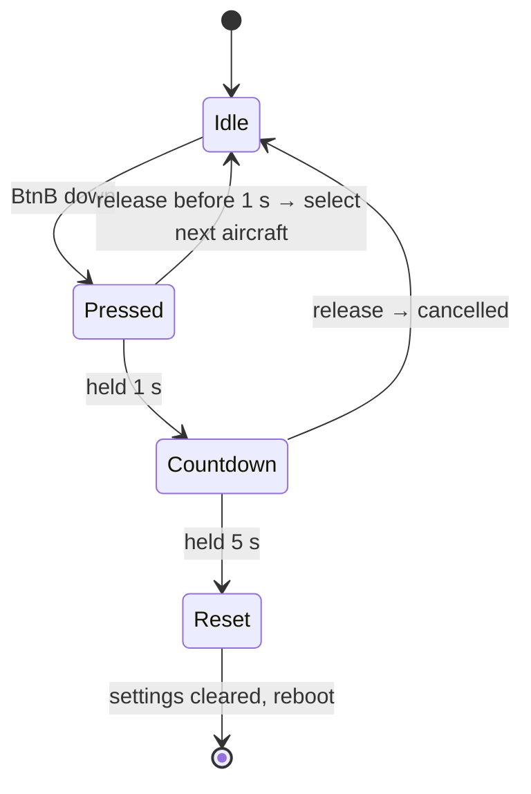
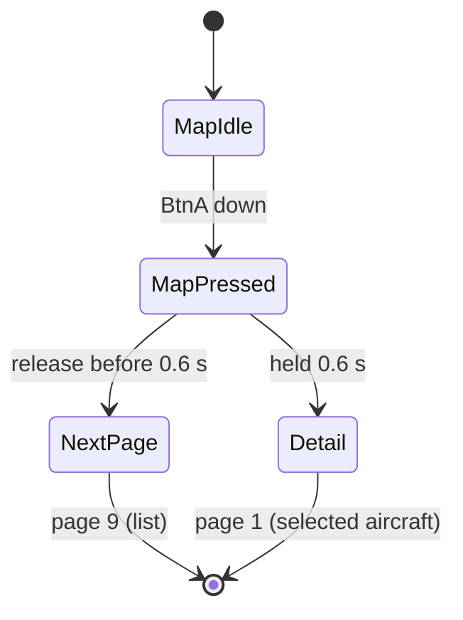
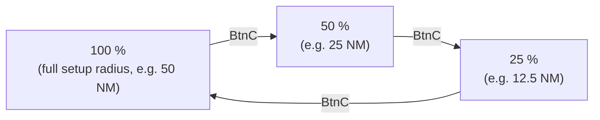
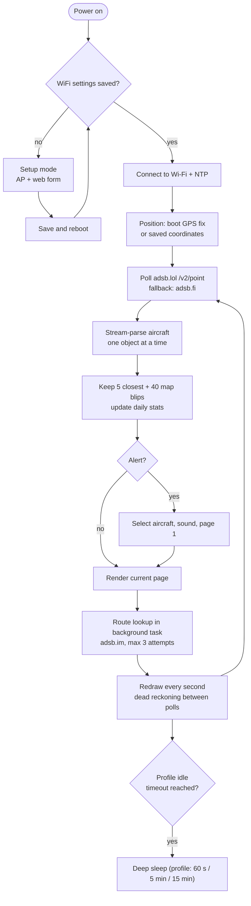

# nearPlane+ – ADS-B Tracker for M5StickC Plus 2



[](https://github.com/svatec/nearplane-plus/actions/workflows/build.yml)
<br>**Firmware v4.3** · build checked on every push

**nearPlane+** turns an `M5StickC Plus 2` that is dying in your stuff drawer (I know you have one, everybody does, no worries) into a portable, real-time aircraft tracker. No need to check Flightradar or anything else. It is perfect for aviation enthusiasts, curious minds, and anyone who has ever looked up at the sky and wondered, "What plane is that?"

This repository is a fork of [nearPlane](https://github.com/stevenselcuk/nearPlane) by **Steven J. Selcuk**. The original idea, base firmware and installation workflow come from him. This fork keeps that foundation and extends it with more pages, multiple aircraft, a radar map, alerts, daily statistics and several reliability fixes. See [Credits](#credits).

**Brand vs. technical names:** the application is branded **nearPlane+**. Technical identifiers keep their ASCII-safe, upstream-compatible names: the repository `nearplane-plus`, the Arduino sketch `nearPlane/nearPlane.ino` and the setup AP `nearPlane-ADSB-Tracker-Setup`.

The tracker normally fetches data from **adsb.lol**, a free, open-source, community-driven project that collects and provides real-time `ADS-B` (Automatic Dependent Surveillance-Broadcast) data from aircraft around the world. This allows you to see detailed flight information without needing your own expensive radio hardware. If adsb.lol rate-limits the device, it automatically switches to the **adsb.fi** open-data fallback. Flight routes are resolved through **adsb.im**.

## Features

### Tracking and display

- **Real-time tracking** – the closest aircraft's data is updated every few seconds, with dead reckoning between API polls.
- **Multiple aircraft** – the 5 closest aircraft are tracked; `BtnB` selects the next one.
- **Twelve-page interface** – flight data, attitude, speeds, autopilot, identity, environment, direction/CPA, radar map, nearby list, daily statistics, military statistics and data quality.
- **Data quality page** – source of the position (ADS-B / MLAT / TIS-B), position age, NIC/RC, NACp/SIL, ADS-B version, emitter category and registration country. Stale targets (>60 s) are dimmed and disappear after 180 s.
- **Unit switch** – `BtnC` short press toggles km/ft ↔ NM/FL on every page except the map (where it changes the scale). Only distance and altitude fields change: page 1/3/4 altitude (`35000 ft` ↔ `FL350`), pages 7/9/10 distance, page 12 QNH/FMS. Pages 2, 5, 6 and 11 contain no distance or altitude, and speed/wind stay in knots.
- **Flight route information** – departure and arrival airports (IATA codes) for most commercial flights, fetched once per selected aircraft.
- **Radar map** – north-up top-down view with up to 40 aircraft, range rings and three percentage-based scale steps.
- **Direction and distance** – arrow to the aircraft, distance in km, bearing, approach/recede trend and closest point of approach (CPA).
- **Type and airline names** – ICAO type codes (`B738` → `Boeing 737-800`) and callsign prefixes (`RYR1234` → `Ryanair`), with a marquee for long header lines.
- **Daily statistics** – number of aircraft, closest, highest and fastest aircraft of the day, persisted across reboots.
- **Military statistics** – daily table of military aircraft grouped by type and registration country, with unique-aircraft counts, 4 records per page, `BtnC` paging, NVS persistence and a midnight reset.
- **Sightings log** – a CSV log on LittleFS with download and clear buttons on the setup page.
- **OTA updates** – upload a new `.bin` over the setup access point, no USB needed after the first flash.
- **Rate-limit aware** – reads `x-ratelimit-remaining` and switches to the fallback source before the daily quota runs out.

### Alerts and hardware

- **Emergency alerts** – aircraft with emergency squawk codes (7500, 7600, 7700) are highlighted.
- **Military, rare and watchlist alerts** – a coloured banner, a distinct sound and automatic selection of the aircraft. The watchlist matches registrations, callsigns, types and ICAO hex codes (`OK-*`, `SP-*`, `@DLH`, `A388`).
- **Close-pass and overhead alarms** – a CPA alarm when an aircraft will pass closer than 2 km within 2 minutes, and an overhead alarm when its elevation exceeds 70°. Both thresholds and every alert type can be changed in the setup form.
- **Quiet hours** – no sounds between 22:00 and 07:00 (configurable); alerts stay visible.
- **Audible alerts** – a tone plays when a new aircraft is detected; alerts have their own sounds.
- **Buzzer on/off** – hold `BtnC` for 0.75 seconds (750 ms) to mute or unmute all sounds; the setting is saved.
- **Boot-time GPS fix (optional)** – with an M5Stack GPS Unit v1.1 on the Grove port the tracker takes one position fix at cold boot, saves it to flash and switches the module off; the saved position is reused after deep-sleep wakes. See [GPS module](#gps-module-optional).
- **Battery and charging indicator** – battery level with colour coding and a charging icon in the header.
- **Power profiles** – Normal / Balanced / Eco control poll interval, brightness, Wi-Fi TX power and idle sleep; Balanced is the default.
- **Auto-dim** – Balanced and Eco dim the backlight after 60 / 30 seconds without a button; any button restores it.
- **Power diagnostics** – optional 10-second battery-current CSV (`/power.csv`) with download/clear in setup, plus `[POWER]` serial lines.
- **Clock in the header** – synchronised over NTP with automatic CET/CEST daylight saving (change `TZ_INFO` in the sketch for another zone).
- **Easy web-based configuration** – an access-point setup mode for Wi-Fi, location (prefilled from the GPS when available), scan radius, the User-Agent contact and the GPS switch.
- **Factory reset** – hold `BtnB` for 5 seconds to clear all settings and return to setup mode.
- **Automatic deep sleep** – after 2 minutes without aircraft or button activity the device sleeps for 5 minutes in Balanced (profiles vary); it never sleeps while charging.
- **Self-healing connection** – lost Wi-Fi is reconnected automatically (backoff 5–60 s); after 10 minutes without a connection the device returns to setup mode. The setup access point switches itself off after 10 minutes of inactivity (unless charging), so it cannot drain the battery.

## Requirements

| Item | Details |
|---|---|
| Board | M5StickC Plus 2 (M5Stack Arduino core) |
| Libraries | `M5Unified`, `ArduinoJson` 7.x |
| Network | 2.4 GHz Wi-Fi with internet access (adsb.lol, adsb.fi, adsb.im, NTP) |
| GPS (optional) | M5Stack GPS Unit v1.1 (AT6668 + MAX2659) on the Grove port, see [GPS module](#gps-module-optional) |
| USB | USB-C data cable; CH9102 driver on Windows |
| API contact | Your own e-mail or URL in the setup form's **User-Agent** field (required by adsb.lol) |

The sketch must live in a folder with the same name: `nearPlane/nearPlane.ino`. Otherwise the linker reports undefined references to `setup` and `loop`.

## Before first use

The first-start setup form asks for a **User-Agent** that identifies your device to adsb.lol. Enter your real e-mail or a URL, for example `nearPlane-M5Stick/1.0 (you@example.com)`. The pre-filled `CHANGE-ME` placeholder is rejected, as are values without `@` or `http(s)://`.

The value is stored in flash under the NVS key `ua` and is used for adsb.lol, the adsb.fi fallback and route requests. The built-in `USER_AGENT` constant is only a dummy fallback (`changeme@example.com`) and is not a valid contact. If you upgrade from a version without this field, reset the settings (hold `BtnB` for 5 seconds) and enter your own contact in the setup form. A generic or shared contact can cause HTTP 403.

## Install

The upstream project is available in **M5Burner** as "nearPlane". This fork contains additional features, so build it from source using the guide below, or use a prebuilt OTA release if your device already runs the 8 MB OTA layout.

### Prerequisites

- Buy an M5StickC Plus 2 (ask your partner before ordering one).
- Install [Arduino IDE](https://www.arduino.cc/en/software).
- Get a USB-C cable for programming and charging.

### Installation guide

Follow these steps to compile and upload the firmware to your M5StickC Plus 2.

#### 1. Install the USB driver

The M5StickC Plus 2 uses a CH9102 chip for USB communication. Install the driver for your operating system so your computer can communicate with the device.

- **Windows**: [Download and install the CH9102 driver](https://docs.m5stack.com/en/core/M5StickC%20PLUS2).
- **macOS**: macOS should detect the device automatically. If not, the driver is available on the same M5Stack documentation page.

#### 2. Configure Arduino IDE for M5Stack

1. Open the Arduino IDE.
2. Go to **File > Preferences** (or **Arduino IDE > Settings...** on macOS).
3. In the "Additional boards manager URLs" field, paste:

   ```
   https://m5stack.oss-cn-shenzhen.aliyuncs.com/resource/arduino/package_m5stack_index.json
   ```

4. Click **OK**.

#### 3. Install M5StickC Plus 2 board support

1. Go to **Tools > Board > Boards Manager...**.
2. Search for `M5Stack`.
3. Install the **M5Stack Boards** package by M5Stack.

#### 4. Install required libraries

1. Go to **Tools > Manage Libraries...** (or **Sketch > Include Library > Manage Libraries...**).
2. Search for and install:
   - `M5Unified` (latest version).
   - `ArduinoJson` by Benoit Blanchon (7.x).

#### 5. Load and flash the firmware

1. Clone this repository or download the source code.
2. Open `nearPlane/nearPlane.ino` in the Arduino IDE.
3. No code edit is needed for the User-Agent: you will set your own contact in the setup form (see [Before first use](#before-first-use)).
4. Optionally change `TZ_INFO` if you are outside the CET/CEST zone (default `"CET-1CEST,M3.5.0,M10.5.0/3"`); daylight saving is handled automatically.
5. Connect the M5StickC Plus 2 to your computer with the USB-C cable.
6. Go to **Tools > Board** and from the "M5Stack Arduino" section select **M5StickCPlus2**.
7. Go to **Tools > Port** and select the serial port of your device (e.g. `COM3` on Windows, `/dev/cu.wchusbserial...` on macOS).
8. Click **Upload** (the arrow icon) to compile and flash the firmware.

### Build with PlatformIO (optional)

The Arduino IDE workflow above stays the recommended path. For a reproducible build with pinned library versions there is a `platformio.ini` in the repository root:

```bash
pio run                # build
pio run -t upload      # flash over USB
pio device monitor     # serial monitor, 115200 baud
```

The project uses a custom 8 MB partition table (`partitions_8mb_ota.csv`): two 3 MB application slots for OTA updates and a ~1.9 MB LittleFS partition for the sightings log. With the 4 MB default table the firmware does not fit. **Flashing this layout the first time requires USB** (`pio run -t upload`, or the Arduino IDE with an equivalent OTA partition scheme); after that, updates can be uploaded over the setup access point. GitHub Actions runs the same build on every push and pull request (`.github/workflows/build.yml`); tags matching `v*` are built and published by `.github/workflows/release.yml`.

### Prebuilt firmware (GitHub Releases)

Tagged releases contain a CI-built OTA image (`nearPlane-plus-<version>-m5stickc-plus2-ota.bin`) and `SHA256SUMS` from [GitHub Releases](https://github.com/svatec/nearplane-plus/releases). The release workflow builds the exact tagged commit with the same pinned PlatformIO environment.

1. Enter setup mode: hold `BtnA` while powering the device on.
2. Connect to `nearPlane-ADSB-Tracker-Setup` and open `http://192.168.4.1/update`.
3. Upload the release `.bin` and wait for the reboot.
4. Optionally verify the checksum (`sha256sum` on Linux, `shasum -a 256` on macOS) against `SHA256SUMS`.

The release image is an **OTA application image for the M5StickC Plus 2 with the 8 MB OTA layout** (`partitions_8mb_ota.csv`). The first USB flash still requires the source build or a factory image; releases do not replace that step. Builds are unsigned, so flash at your own risk.

### Device configuration

After a successful flash, the device boots into **SETUP MODE** for the first time (or after a settings reset).

1. On your phone or computer, connect to the Wi-Fi network **`nearPlane-ADSB-Tracker-Setup`**.
2. Open `http://192.168.4.1` in a browser.
3. Fill in:
   - **WiFi Network (SSID)** – the name of your local 2.4 GHz network. Prefilled when settings already exist.
   - **WiFi Password** – the password for that network (never prefilled).
   - **Your Latitude** – e.g. `41.015000`. Prefilled when a GPS module has a fix.
   - **Your Longitude** – e.g. `28.97000`. Prefilled when a GPS module has a fix.
   - **Scan Radius (NM, max 250)** – the radius around your location, in nautical miles (e.g. `50`; 1 NM = 1.852 km). Prefilled with the stored value.
   - **Units** – km/ft (default) or NM/FL. Can also be switched with `BtnC` outside the map.
   - **Power profile** – Normal (15 s poll, 100 % brightness), Balanced (30 s, 70 %) or Eco (60 s, 50 %). Also controls Wi-Fi TX power, auto-dim and idle sleep.
   - **Hide aircraft on the ground** – enabled by default; ground targets are left out of the list and the map.
   - **User-Agent** – your e-mail or URL; the value is stored in flash and used for adsb.lol, adsb.fi and route requests. Prefilled when already set.
   - **Watchlist** – comma separated patterns: `OK-*` (registration prefix), `SP-*`, `@DLH` (callsign prefix), `A388` (type), `4CA123` (hex). Up to 10 rules.
   - **CPA alarm distance / time window** – defaults 2 km and 2 minutes.
   - **Overhead alarm elevation** – default 70°.
   - **Quiet hours** – from/to in whole hours (default 22–07); set both to the same value to disable.
   - **Alarm toggles** – emergency, military, rare, watchlist, CPA and overhead can be switched off individually.
   - **Log sightings to flash** – writes a CSV row per aircraft per 5 minutes to LittleFS (enabled by default).
   - **Log power samples to flash** – optional 10-second battery-current CSV for measurements (off by default).
   - **Use GPS module (fix only at boot)** – enabled by default; the device takes one fix at cold boot and then powers the module off. Untick it to always use the coordinates above.
4. Click **Save & Reboot**.

Values are validated on the device: the SSID must have 1–32 characters, latitude must be between -90 and 90, longitude between -180 and 180 and the radius a whole number from 1 to 250. A rejected value shows an error page instead of silently storing garbage.

The device saves the settings, restarts, connects to your Wi-Fi and starts tracking. Stats and the clock require a working NTP connection.

The setup access point switches itself off after 10 minutes of inactivity (it stays on while charging). The form is prefilled from flash, so reconfiguring does not require retyping the SSID, radius or User-Agent.

The page also offers **Download log**, **Clear log**, **Download power log**, **Clear power log** and **Firmware update**. Hold `BtnA` while powering the device on to enter setup mode without a factory reset.

### Sightings log

Every aircraft is written to `/log.csv` on LittleFS at most once per 5 minutes:

```csv
2026-10-25T21:50:12,4bb4f0,MGH795,TC-MGP,B738,36000,450,12.3,ADS-B
time,hex,callsign,reg,type,alt_ft,gs_kt,dist_km,source
```

- Download from the setup page (`/log.csv`), clear with the button (`/log/clear`).
- Rotation at 256 kB: the current file becomes `/log.old.csv`, the previous old file is deleted.
- Rows are only written when NTP has synchronised, otherwise the timestamp would be wrong.
- The log can be disabled without losing the ability to download or clear it.

### Firmware update (OTA)

The custom partition table has two 3 MB application slots, so a new `.bin` can be uploaded from the setup page (`/update`) without USB. Hold `BtnA` at power-on, connect to `nearPlane-ADSB-Tracker-Setup`, open `http://192.168.4.1/update` and upload the `firmware.bin` built by PlatformIO or exported from the Arduino IDE. The device validates the image, reboots into it and keeps the previous slot as a rollback target. OTA is not available if the device runs a partition layout without a second app slot.

If a GPS module is connected, the setup page shows the last saved fix and prefills the coordinates. Without a saved fix, enter them by hand; a new fix is attempted at the next cold boot.

### GPS module (optional)

With an M5Stack GPS Unit v1.1 (AT6668 + MAX2659, NMEA 0183, 115200 baud) plugged into the Grove port, the tracker takes **one position fix at cold boot**, stores it in NVS and switches the Grove 5 V output off. The saved fix is reused after deep-sleep wakes and normal reboots; the module is not kept running.

| Aspect | Behaviour |
|---|---|
| Wiring | Grove port (G32 / G33). Wire orientation and baud rate (115200 or 9600) are **detected automatically**; no setting is needed |
| Detection | Cold boot only: up to ~13 s for module detection and a 60 s total window for a fix. The 5 V output is cut immediately after the fix or timeout |
| Position used | The persisted boot fix (also after deep-sleep wakes) until the next cold boot with GPS; otherwise the position saved in setup. The API query, distances, bearings and the radar map follow the current position |
| Indicator | Top right, below the clock: **GPS** = fix available (live or saved), **GPS?** = module found, waiting for a fix. Nothing is shown after a timeout without a fix |
| Setup form | Latitude and longitude are prefilled from the last fix; the checkbox **Use GPS module (fix only at boot)** enables the boot attempt |
| Cold start | The first fix takes about 25 s outdoors (23 s cold start per the datasheet); indoors it may never arrive |

Notes:

- The older GPS Unit (AT6558, 9600 baud) works too. A GPS **Hat** on the 8-pin header uses other pins and is not detected; add its pins to `GPS_PINS` in the sketch.
- The unit needs 5 V from the Grove port. The sketch enables the output only for the boot attempt and turns it off afterwards; this removes the continuous GPS standby load.
- No continuous position updates: if you move the device while it runs, power-cycle it to take a new fix. The serial monitor shows `[GPS] boot fix attempt`, `[GPS] fix saved` and `[GPS] powered off (boot-only)`.

### Power profiles

| Setting | Normal | Balanced (default) | Eco |
|---|---|---|---|
| Poll with aircraft | 15 s | 30 s | 60 s |
| Poll without aircraft | 30 s | 60 s | 120 s |
| Brightness | 100 % | 70 % | 50 % |
| Auto-dim | off | 60 s → 20 % | 30 s → 10 % |
| Wi-Fi TX power | 19.5 dBm | 11 dBm | 8.5 dBm |
| Idle deep sleep | 5 min → 60 s | 2 min → 5 min | 2 min → 15 min |

- Any button restores the configured brightness after auto-dim.
- Deep sleep never runs while charging.
- After a deep-sleep wake the device polls once and sleeps again after 30 s if there are no aircraft.
- **Power log:** enable `Log power samples to flash` in setup; the device writes `/power.csv` every 10 s. For a battery test, charge it, unplug USB, let it run, then download the CSV and average the `mA` column. `epoch` is Unix time when NTP is synced, otherwise uptime seconds. `[POWER]` lines are also printed to the serial monitor.

## Usage

### Controls

| Page | `BtnA` short | `BtnA` long (0.6 s) | `BtnB` short | `BtnB` hold 1 s → 5 s | `BtnC` short (side/PWR) |
|---|---|---|---|---|---|
| 1–6 Aircraft data | next page | next page | next aircraft | countdown → reset | units km/ft ↔ NM/FL |
| 7 Direction / CPA | next page | next page | next aircraft | countdown → reset | units km/ft ↔ NM/FL |
| **8 Radar map** | next page | **jump to page 1 (detail)** | next aircraft **inside current scale** | countdown → reset | **change scale** |
| 9 Nearby list | next page | next page | next aircraft (highlighted row) | countdown → reset | units km/ft ↔ NM/FL |
| 10 Statistics | next page | next page | – (no visible effect) | countdown → reset | units km/ft ↔ NM/FL |
| 11 Military stats | next page | next page | – (no visible effect) | countdown → reset | next page of types |
| 12 Data quality | next page | next page | next aircraft | countdown → reset | units km/ft ↔ NM/FL |

Notes:

- On pages other than the map, `BtnA` acts immediately on press. On the map it acts on release so a long press can be distinguished from a short one.
- `BtnC` is the third button of the StickC Plus 2 (the power button, exposed as `M5.BtnPWR`).
- **`BtnC` hold 0.75 seconds (750 ms) on any page toggles the buzzer.** A "Sound ON/OFF" message appears, and a crossed-out speaker icon is shown next to the battery while muted. The setting survives reboots and is cleared by a settings reset. Alerts remain visible; only the sounds are muted.
- `BtnC` short press acts on release, so it can be distinguished from the 0.75-second hold.
- Outside the map, `BtnC` short press switches between **km/ft** and **NM/FL**; the choice is stored in flash.
- Releasing `BtnB` during the reset countdown cancels the reset.

### BtnC behaviour

```mermaid
stateDiagram-v2
    [*] --> Idle
    Idle --> Pressed: BtnC down
    Pressed --> Idle: release before 0.75 s → map: cycle scale 100 / 50 / 25 %; other pages: toggle units
    Pressed --> Toggled: held 0.75 s
    Toggled --> Idle: release (buzzer toggled, saved)
```



### BtnB behaviour



### BtnA behaviour on the radar map



### Pages

Twelve pages, advanced with `BtnA`. Pages 1–7 show the currently selected aircraft; pages 8–12 are overview pages.

```mermaid
flowchart LR
    P1["1 Flight data<br/>ALT / GS / ROUTE"]
    P2["2 Attitude<br/>HDG / V/S / ROLL"]
    P3["3 Speeds<br/>MACH / IAS-TAS / GEOM ALT"]
    P4["4 Autopilot<br/>AP ALT / HDG / MODE"]
    P5["5 Identity<br/>SQK / ICAO / REG"]
    P6["6 Environment<br/>OAT-TAT / WIND / RSSI"]
    P7["7 Direction<br/>arrow / distance / trend / CPA"]
    P8["8 Radar map<br/>north-up, scalable"]
    P9["9 Nearby list<br/>5 closest aircraft"]
    P10["10 Statistics<br/>today's records"]
    P11["11 MIL TODAY<br/>4 types + count"]
    P12["12 Data quality<br/>SRC / NIC / NACp"]

    P1 -->|BtnA| P2 -->|BtnA| P3 -->|BtnA| P4 -->|BtnA| P5 -->|BtnA| P6 -->|BtnA| P7
    P7 -->|BtnA| P8 -->|BtnA| P9 -->|BtnA| P10 -->|BtnA| P11 -->|BtnA| P12 -->|BtnA| P1
    P8 -. "BtnA long press (0.6 s)" .-> P1
    P8 -. "BtnC: scale 100 / 50 / 25 % of radius" .-> P8

    classDef aircraft fill:#1f3a5f,stroke:#4a90d9,color:#fff;
    classDef overview fill:#2d4a2d,stroke:#6abf69,color:#fff;
    class P1,P2,P3,P4,P5,P6,P7 aircraft;
    class P8,P9,P10,P11,P12 overview;
```



An **alert** (emergency, military, watchlist, rare aircraft, close pass or overhead) automatically selects that aircraft, jumps to page 1 and plays a sound (unless quiet hours are active).

**Page 12 – data quality** shows the source of the position (`ADS-B`, `MLAT`, `TIS-B`, `ADS-C`), phase of flight (`CLB`, `CRZ`, `DES`, `APP`, `TAXI`) with its age in seconds, NIC/RC, NACp/SIL, ADS-B version, emitter category (e.g. `A3 Large`, `A7 Rotorcraft`), wind components and the registration country derived from the registration prefix. There is no status footer: pages contain only the data itself, and the version is shown in the setup page and the serial banner.

### Radar map scale

`BtnC` cycles the map radius relative to the scan radius from the setup form; the inner ring is always half of the outer one.



With the default 50 NM radius the steps are 50 NM → 25 NM → 12.5 NM. The map label shows the percentage and the absolute range (e.g. `R 50% 25.0 NM`). If the selected aircraft is outside the current scale, it is shown as a yellow dot on the rim and its distance is drawn on the map (e.g. `SEL 24.1 km`).

### Alerts

| Event | Banner colour | Trigger |
|---|---|---|
| EMERGENCY | red | emergency flag or squawk 7500 / 7600 / 7700 |
| CPA | red | closest point of approach below the configured distance and time (default 2 km / 2 min) |
| OVERHEAD | yellow | elevation above the configured angle (default 70°) |
| MILITARY | orange | military flag in the database |
| WATCH | magenta | registration / callsign / type / hex matches the watchlist |
| RARE | cyan | A380, B747-400/-8/SP, An-124, An-225, Beluga/BelugaXL, Dreamlifter, C-5M, Il-76, A340-600 |

Each event is evaluated after every poll and the highest priority wins (emergency → CPA → overhead → military → watch → rare). The same aircraft does not repeat the same alert for 5 minutes, and alerted aircraft are kept in the list of 5 even when they are not the closest. CPA and overhead alerts show their value in the header line (e.g. `CPA 1.4 km / 90s`); every alert type can be disabled in the setup form. Sounds are muted during quiet hours, but the banner and selection still happen.

## How it works



### Polling intervals

| Situation | Interval |
|---|---|
| Aircraft found | 15 / 30 / 60 s (Normal / Balanced / Eco) |
| No aircraft | 30 / 60 / 120 s |
| Other error (parse, 5xx, timeout) | max(idle interval, 60 s) |
| HTTP 429 (rate limit) | 20 s, doubling up to 120 s (the `Retry-After` header wins); the fallback server is tried immediately; last data stays on screen |
| Redraw of pages 7–9 (local calculation, no API call) | 1 s |
| Route lookup (adsb.im, background task) | once per selected aircraft; a failed lookup is retried after 60 s, max 3 attempts |

If adsb.lol answers 429, the sketch immediately retries the same request on `opendata.adsb.fi` and keeps using it until the primary block expires.

Between polls, positions on pages 7–9 are recalculated every second from ground speed and track (no API calls). A long airline/type line in the header scrolls as a marquee.

## Troubleshooting

| Symptom | Likely cause |
|---|---|
| HTTP 403 "User-Agent too generic" | Enter your own e-mail or URL in the setup form's **User-Agent** field; the built-in fallback is a dummy address and will not work |
| HTTP 429 | adsb.lol rate limit (other clients behind the same IP or frequent reboots can cause it). The device shows "Rate limited" with a countdown, switches to adsb.fi and retries automatically |
| HTTP 426 | HTTP/1.0 request; the sketch uses HTTP/1.1 with chunked decoding |
| Linker error `undefined reference to setup/loop` | File/folder name mismatch (`nearPlane/nearPlane.ino`) |
| Reboot loop | Check the serial monitor (115200 baud) for the `Reset reason:` line |
| No reaction to `BtnC` | The power button is not detected by your board or library version |
| `GPS?` never turns into `GPS` | No fix within the 60 s boot window. Move the unit outdoors and power-cycle it; the module is switched off after the attempt |
| No `GPS` indicator at all | Module not detected at boot: check the Grove cable and that **Use GPS module (fix only at boot)** is enabled |
| Power log is empty | Enable **Log power samples to flash**, wait at least 10 s, then download `/power.csv` |
| Wi-Fi dropped and never came back | Fixed in v4.1: the device reconnects with a 5–60 s backoff; after 10 minutes without a connection it opens the setup AP again |
| Setup Wi-Fi disappeared while configuring | Setup-mode idle timeout (10 minutes, paused while charging). Power-cycle the device to reopen it, or hold `BtnB` 5 s for a settings reset |
| Clock off by one hour | `TZ_INFO` does not match your timezone; the default is CET/CEST with automatic daylight saving |
| Route stays `- > -` | The route lookup failed 3 times for that aircraft; select another aircraft or wait for the next poll |
| Log is empty | NTP has not synchronised yet, logging is disabled in setup, or the aircraft list is empty; check `[LOG]` in the serial output |
| Firmware update page says "no second app slot" | The device was flashed with the old partition table; flash `partitions_8mb_ota.csv` over USB once |
| Settings missing after a partition change | NVS is preserved at its fixed offset; if you erased the whole flash, reconfigure the device |

### Diagnostics (serial)

The serial monitor (115200 baud) prints one prefixed line per subsystem:

| Prefix | Meaning |
|---|---|
| `[LOOP]` | heartbeat every 5 s: Wi-Fi state, next poll, aircraft count, free heap, GPS state, home position |
| `[WIFI]` | connection lost / reconnect attempt with backoff / reconnected / fallback to setup mode |
| `[SETUP]` | setup access point idle timeout |
| `[ROUTE]` | background route lookup result and HTTP code |
| `[ALERT]` | triggered alert with its callsign and banner text |
| `[WATCH]` | number of parsed watchlist rules |
| `[UI]` | `BtnC` press/release timings, unit and sound changes |
| `[LOG]` | LittleFS mount, rotation, cleared log |
| `[CACHE]` | number of route and enrichment entries loaded from NVS |
| `[ENRICH]` | background `/v2/hex` lookup and cache writes |
| `[RATE]` | remaining data-source quota and proactive switch to the fallback |
| `[OTA]` | firmware upload progress and result |
| `[AIRCRAFT]` | API poll, HTTP status, scan counters, heap before/after TLS |
| `[GPS]` | boot fix attempt, saved fix, module detection, power-off |
| `[POWER]` | 10 s battery current, level, Wi-Fi state, page, poll interval, GPS state, brightness |

## Data sources

- Primary: [adsb.lol](https://adsb.lol) (open data, ODbL).
- Fallback while adsb.lol rate-limits: [adsb.fi open data](https://adsb.fi) – personal, non-commercial use only; credit adsb.fi and link to https://adsb.fi.
- Route lookup: adsb.im.
- Type enrichment: `api.adsb.lol/v2/hex/{hex}`, only for aircraft whose type is not in the local table, cached for 30 days.

### Data-source quota

adsb.lol allows a limited number of requests per day (the API returns `x-ratelimit-remaining` and `x-ratelimit-reset`, currently 500/day per IP). The firmware reads both headers:

- below 20 remaining requests the primary source is blocked and the fallback (adsb.fi) is used;
- below 5 remaining requests polling slows to 60 s;
- enrichment requests are skipped while the remaining quota is below 50.

Route lookups are cached for 7 days per callsign (`rcache` in NVS), enrichment results for 30 days (`ecache`), so repeat requests are avoided.

Only an average interval of at least ~3 minutes stays within the 500/day quota. Normal and Balanced trade this for responsiveness and therefore use the fallback source for part of the day.

## Limitations

- No compass: the arrow and map are always north-up. With the GPS enabled, distances and the map follow your position, but the orientation stays north-up.
- Stats and the clock need a working NTP connection.
- `setInsecure()` disables TLS certificate validation (acceptable for public flight data).
- Built-in type/airline tables cover about 100 types and 80 airlines; extend `TYPE_NAMES` / `AIRLINES` in the sketch.
- The scan radius is entered in nautical miles (max 250), not kilometres.
- The setup access point is open (no password) and serves plain HTTP; configure the device at home, not in a public place.
- Position quality fields (`MLAT`, `NIC`, `RC`, `NACp`, `SIL`) are provided by the data source; when the API omits them the page shows `---`.
- The sightings log needs NTP for timestamps and rotates at 256 kB per file (two files max).
- OTA works only while the device is in setup mode (access point), not over the local Wi-Fi network.

## Changelog

The detailed bilingual changelog (English/Slovak) with controls and release notes is in [`nearPlane/CHANGELOG.md`](nearPlane/CHANGELOG.md).

### This fork

- Twelve pages instead of six, including radar map, nearby list, daily statistics, military statistics and data quality.
- Tracks the 5 closest aircraft and switches between them with `BtnB`.
- Direction page with dead reckoning, approach/recede trend, bearing and CPA.
- Emergency, military and rare aircraft alerts with coloured banners, sounds and automatic selection.
- Radar map with up to 40 aircraft and three percentage-based scale steps.
- Daily statistics stored in NVS: aircraft count, closest, highest and fastest aircraft.
- Human-readable aircraft types and airline names, with a scrolling header line.
- Buzzer mute via `BtnC`, battery/charging indicator and clock in the header.
- Streaming JSON parsing for low memory usage; route fetched once per aircraft.
- Fixed HTTP 403/426/429 handling, automatic adsb.fi fallback, configurable User-Agent in the setup form, exponential polling backoff and serial diagnostics.
- Setup radius corrected to nautical miles (max 250) and deep sleep after inactivity.
- Optional GPS module (M5Stack GPS Unit v1.1) with automatic pin/baud detection, a boot-time fix saved to flash and a prefilled setup form.
- **v4.1 – robustness:** Wi-Fi auto-reconnect with backoff and fallback to the setup AP, setup-mode idle timeout, route lookup moved to a background task (UI and buttons no longer freeze) with up to 3 retries, server-side validation of the setup form, prefilled setup fields, automatic daylight saving via `TZ_INFO`, firmware version in the setup page and serial banner.
- **v4.1 – build:** `platformio.ini` with pinned library versions, GitHub Actions compile check, build artifacts and `.DS_Store` removed from git.
- **v4.2 – data quality:** page 11 shows the position source and age, NIC/RC, NACp/SIL, ADS-B version, emitter category and registration country.
- **v4.2 – alerts and storage:** watchlist rules, CPA and overhead alarms, quiet hours, a LittleFS sightings log, route/enrichment caches, quota-aware fallback and OTA updates.
- **v4.3 – radar scale:** map steps are **100 / 50 / 25 %** of the configured scan radius; the default 50 NM radius gives 50 → 25 → 12.5 NM.
- **v4.4 – military statistics:** page 11 (`MIL TODAY`) lists military aircraft by type and registration country with daily unique counts, 4 records per page and `BtnC` paging; stored in NVS and reset at midnight.
- **v4.5 – power:** Normal/Balanced/Eco profiles, 70 % brightness with auto-dim, boot-only GPS with NVS fix reuse, Wi-Fi TX power control, loop yield, no deep sleep while charging and optional `/power.csv` battery diagnostics.

### Upstream history

**v1.1 – Sep 10, 2025**

- **Flight route fetching**: switched to a `POST` request to the `https://api.adsb.lol/api/0/routeset` endpoint with the aircraft callsign, providing more accurate departure and arrival airports without external API keys.
- Solved previous issues with empty or incorrect route information.

**v1.0 – Sep 9, 2025**

- **Initial release**: bare/minimum working copy.

## Contributing

Contributions are welcome. If you would like to help improve this fork:

1. **Fork** this repository on GitHub.
2. Create a new **branch** for your feature or bug fix.
3. Make your changes and commit them with clear, descriptive messages.
4. Push your branch to your forked repository.
5. Create a **Pull Request (PR)** against this repository and explain the changes.

## Credits

This project is a fork of **[nearPlane](https://github.com/stevenselcuk/nearPlane)** by **[Steven J. Selcuk](https://github.com/stevenselcuk)**. Thank you for the original firmware, the detailed build and setup guide, the UI concept and for releasing the project under the MIT license. The base implementation and a large part of this README come from his work.

- Original project and author: [stevenselcuk/nearPlane](https://github.com/stevenselcuk/nearPlane)
- Original inspiration: [Reddit post by ufil1983](https://www.reddit.com/r/ADSB/comments/1nb56ld/nearest_aircraft_display/) and the [follow-up post](https://www.reddit.com/r/ADSB/comments/1nbsb3c/inspired_by_ufil1983s_nearest_aircraft_display_i/)
- Flight data: [adsb.lol](https://adsb.lol)
- Flight routes: [adsb.im](https://adsb.im)

## License

This project is open source under the **MIT License**. Original work Copyright (c) 2025 Steve J. Selcuk; fork modifications are distributed under the same license. See [`LICENSE`](LICENSE) for the full text.
